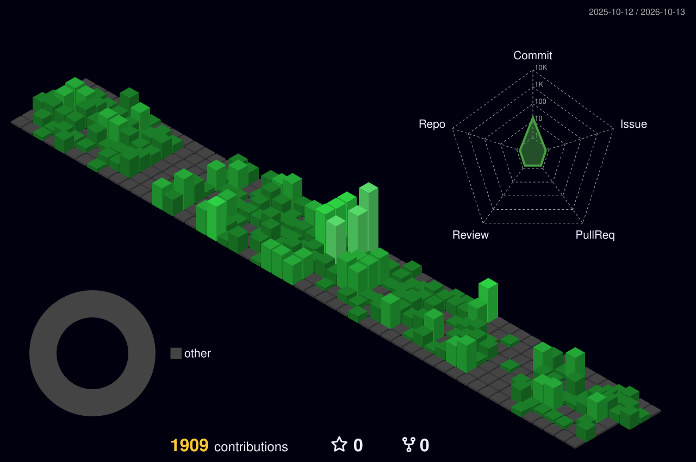

# 👨🏽‍💻

 **📚 Learn more about my** [projects](https://patrickmoreira.netlify.app/)  
 **💼 Connect with me on** [LinkedIn](https://linkedin.com/in/patrick-moreirarosa/)

---

##  Skills   
<div align="center">
<a href="https://skillicons.dev">
  
</a>
</div>

## 🏆 GitHub Trophies
<div align="center">


</div>

## 📊 Stats
<div align="center">


<br/>

</div>

<!--START_SECTION:waka-->

```txt
From: 08 October 2026 - To: 15 October 2026

Total Time: 33 hrs 46 mins

Python       12 hrs 29 mins        ⣿⣿⣿⣿⣿⣿⣿⣿⣿⣄⣀⣀⣀⣀⣀⣀⣀⣀⣀⣀⣀⣀⣀⣀⣀   36.97 %
Markdown     9 hrs 16 mins         ⣿⣿⣿⣿⣿⣿⣷⣀⣀⣀⣀⣀⣀⣀⣀⣀⣀⣀⣀⣀⣀⣀⣀⣀⣀   27.45 %
Other        7 hrs 40 mins         ⣿⣿⣿⣿⣿⣶⣀⣀⣀⣀⣀⣀⣀⣀⣀⣀⣀⣀⣀⣀⣀⣀⣀⣀⣀   22.70 %
JSON         3 hrs 17 mins         ⣿⣿⣦⣀⣀⣀⣀⣀⣀⣀⣀⣀⣀⣀⣀⣀⣀⣀⣀⣀⣀⣀⣀⣀⣀   09.74 %
TypeScript   25 mins               ⣤⣀⣀⣀⣀⣀⣀⣀⣀⣀⣀⣀⣀⣀⣀⣀⣀⣀⣀⣀⣀⣀⣀⣀⣀   01.26 %
Text         22 mins               ⣤⣀⣀⣀⣀⣀⣀⣀⣀⣀⣀⣀⣀⣀⣀⣀⣀⣀⣀⣀⣀⣀⣀⣀⣀   01.12 %
Git Config   14 mins               ⣄⣀⣀⣀⣀⣀⣀⣀⣀⣀⣀⣀⣀⣀⣀⣀⣀⣀⣀⣀⣀⣀⣀⣀⣀   00.73 %
Gosu         0 secs                ⣀⣀⣀⣀⣀⣀⣀⣀⣀⣀⣀⣀⣀⣀⣀⣀⣀⣀⣀⣀⣀⣀⣀⣀⣀   00.03 %
```

<!--END_SECTION:waka-->

---



[](https://visitcount.itsvg.in)
